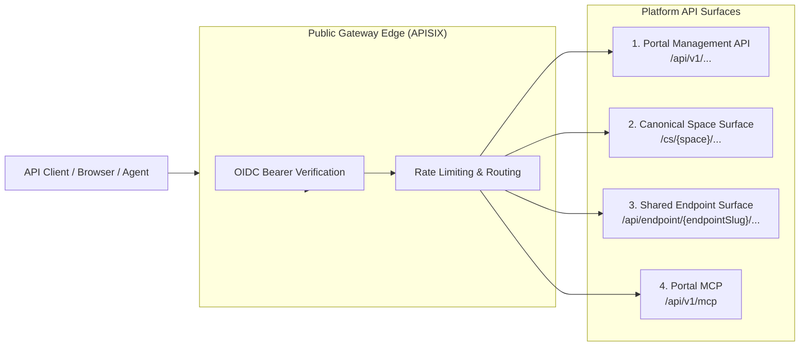

# API Overview & Architecture

joinedcontext exposes standard-first, versioned programmatic interfaces. The platform eliminates custom proprietary APIs in favor of internationally ratified specifications:

- **ETSI GS CIM 009 (NGSI-LD V1.9.1):** Core context data operations. That is the version the default broker implements and the version the conformance suite runs (1822 cases); a page citing an older one is citing a specification this platform does not serve.
- **OGC API - Features Part 1:** Geospatial feature queries.
- **OGC SensorThings API (STA) v1.1:** Time-series sensor streams.
- **Model Context Protocol:** autonomous agent tool integration. The Portal's MCP server negotiates `2026-07-28`, `2025-11-25`, `2025-06-18` or `2025-03-26` and answers with the newest the client names (`joinedcontext-portal/src/mcp/mod.rs`); an endpoint's own MCP server is the broker's MCP surface of its view, and the hub and the named servers speak `2025-06-18` (`joinedcontext-platform/crates/context-gateway/src/mcp/jsonrpc.rs`).
- **OpenAPI 3.1:** Platform management and administrative operations.

---

## 1. Global API Map & Base URLs



| API Surface | Base Path URL | Purpose | Primary Consumer |
|---|---|---|---|
| **Portal Management API** | `https://{host}/api/v1/...` | Managing projects, organizations, blueprints, and approvals | Portal UI, CI systems, admin scripts |
| **Canonical Space Surface** | `https://api.{domain}/cs/{space}/...` | Direct NGSI-LD access for the project owning the space | Project team members, resident pipelines |
| **Shared Endpoint Surface** | `https://api.{domain}/api/endpoint/{endpointSlug}/...`| Multi-representation data consumption (GeoJSON, CSV, OGC, MCP) | Dashboards, external users, QGIS, agents |
| **Portal MCP** | `https://{host}/api/v1/mcp` | The management API as agent tools: proposing manifests, opening changes, reading a project | AI agents (Claude Code, OpenHands) |
| **Endpoint and space MCP** | `https://api.{domain}/api/endpoint/{endpointSlug}/mcp`, `https://api.{domain}/api/mcp` (the hub), `https://api.{domain}/cs/{space}/mcp` | The context data of one endpoint or space as agent tools, under the same Policy as every other read | AI agents |
| **Public documentation** | `https://portal.{host}/docs/API/{page}`, `https://portal.{host}/docs/User-Guide/{page}` | The pages of this API chapter and of the User Guide, readable with no account, so a citizen can use a public Endpoint (T-4063). `{page}` is the file name without `.md`; the apex `https://{host}/docs/...` redirects there. No other chapter (Operations, Deployment, Architecture) is served there | Citizens, external developers |

Every surface that serves data to the outside, the Canonical Space Surface, the Shared Endpoint Surface, the hub and the harvesting feed `/catalog*`, answers on its own host `api.{domain}` (`api.dev.joinedcontext.com` on `dev`); the Portal and its public pages stay on `portal.{domain}`, the open-data catalogue on `opendata.{domain}` ([EP-128](../Requirements/endpoints.md), [ADR-N-052](../Decisions/adr-n-052-anonymous-oauth-public-mcp.md)). Until release `v0.2.0` the old addresses of those four on `{host}` and `portal.{host}` answer `308` to the same path on `api.{domain}`; a client drops its `Authorization` header when it follows a redirect to another host, so a caller with a token changes its address.

---

## 2. Authentication & Security

All API endpoints are protected by default (fail-closed, [R5](../Requirements/access-control.md#1-architecture-and-enforcement-point)).

### Token Requirements

- **Protocol:** OpenID Connect (OIDC) / OAuth 2.1 via Keycloak ([I1](../Requirements/policy-firewall.md#21-identity-stack-i1i4-canonical-here)).
- **Header:** `Authorization: Bearer <jwt>`
- **Token Claims:** Tokens carry client identity (`sub`) and tenant membership only. **Tokens never carry permissions or roles** ([I4](../Requirements/policy-firewall.md#21-identity-stack-i1i4-canonical-here)); permissions are evaluated dynamically at the gateway using stored `Policy` entities.
- **Proof of possession:** not in the MVP. Tokens are bearer tokens, bound to the audience of the endpoint they were minted for and short-lived, which is what [AG-02](../Requirements/agents.md) requires; DPoP proofs (RFC 9449) at the edge come after the MVP (owner decision 2026-09-24).

### Anonymous Public Access

Endpoints with `audience: public` permit unauthenticated access. Requests without a bearer token are mapped automatically to the internal role `public` and evaluated against public data policies ([GW22](../Requirements/gateway-firewall.md#5-tenants-pinning-and-chaining)).

An assistant that connects only through OAuth (Gemini) gets a token for the same anonymous rights from the gateway's own authorization server on `api.{domain}`: it registers, is redirected back at once with no login, and receives a token that names nobody ([EP-129](../Requirements/endpoints.md), [API/02 §8](02-endpoint-representations.md#8-model-context-protocol-mcp)).

---

## 3. Rate Limiting Headers

Two limiters stand in front of a request and they do not speak the same header.

The gateway's own limiter, which an `Endpoint` configures, answers every request on the endpoint and space surfaces with the IETF draft headers (`crates/context-gateway/src/middleware/rate_limit.rs`):

```http
RateLimit-Limit: 1000
RateLimit-Remaining: 942
RateLimit-Reset: 28
```

The edge limiter is APISIX's `limit-count` with `show_limit_quota_header`, which writes `X-RateLimit-Limit` and `X-RateLimit-Remaining` instead (`joinedcontext-deployment/components/portal/apisix-plugins.yaml`). A client that wants one number reads both names.

A caller over its quota gets **HTTP 429 Too Many Requests**, an RFC 7807 problem document and a `Retry-After: <seconds>` header carrying the same seconds as `RateLimit-Reset`.

---

## 4. Standard Error Handling (RFC 7807)

Errors are returned strictly as `application/problem+json` documents:

```json
{
  "type": "https://joinedcontext.com/errors/forbidden",
  "title": "Access Denied by Policy",
  "status": 403,
  "detail": "the write touches an attribute outside the grant: operatorPhone",
  "hint": "Ask a project owner or an organization administrator for the role this needs."
}
```

`type` is always `https://joinedcontext.com/errors/{slug}` (`crates/jc-core/src/error.rs`). `detail` and `instance` are present when there is something safe to say, and never carry an upstream URL, a tenant, a broker error body or a policy name. A `400` or `422` from the Portal may carry `errors`, one `{path, message}` entry per violation: `path` is the member's dotted path as the request wrote it (`spec.history[1]`, `metadata.name`), empty when the finding is about the whole request, so a form marks every bad field in one pass and a client corrects each named member before it sends again (AG-146, T-5949). An MCP tool of the Portal answers a refusal with `isError: true` and the same document as its `structuredContent`.

The extension members (T-3243):

| Member | When | What |
|---|---|---|
| `hint` | every problem whose type is on [Problem Types](09-errors.md) | what the caller does about it, one English sentence; the Portal shows its own translation by the slug |
| `field` | a validation that names one member or parameter | the member, as the request wrote it (`metadata.name`, `id`) |
| `code` | the NGSI-LD surface, where `type` is the ETSI one (CIM 009 5.5.2) | the joinedcontext slug the gateway refused with |
| `requestId` | a `500` | the reference a report is matched to a log line by |

A problem type is one of the slugs [Problem Types](09-errors.md) lists, with what happened and what to do for each: jc-core's `PROBLEM_TYPES` and, for the Portal's own, its `PORTAL_PROBLEM_TYPES`. `ProblemDetails::new` with any other slug fails the platform's catalogue test, a Portal slug outside both lists fails the Portal's, and the docs check fails on a slug with no section on that page (T-4485). A status without a type of its own answers with the generic one for its class. The Portal links the section from every error it shows.

The edge's own `too-many-requests` (the per-address limit of a route) is the one refusal that also comes as a page. A request whose `Accept` names `text/html` (a browser opening a page) gets an HTML page in the language its `Accept-Language` puts first (Slovak, Czech or German, otherwise English). The page says the same thing, names the seconds `Retry-After` names, and links the same address to load it again; it does not reload itself, since a timed reload the reader cannot stop fails WCAG 2.2.1 (T-5078). It loads nothing and runs no script. Every other caller gets the Problem Details above, with the same status and `Retry-After` (T-4201).

### Existence Masking

To prevent reconnaissance, requesting an unauthorized resource via single-entity fetch returns an RFC 7807 **HTTP 404 Not Found** rather than HTTP 403, eliminating existence disclosure ([R20](../Requirements/access-control.md#5-requesting-extra-data)).

---

## 5. Well-Known Discovery Documents

The platform hosts standard well-known endpoints for automated client and agent self-configuration:

- `https://idm.{host}/realms/{realm}/.well-known/openid-configuration`: the realm's own OIDC discovery document. Keycloak serves it; the platform does not proxy it, and the APISIX routes read it from there (`components/portal/apisix-plugins.yaml`).
- `/.well-known/oauth-protected-resource` and `/.well-known/oauth-protected-resource/api/v1/mcp`: RFC 9728 metadata of the Portal MCP server (`joinedcontext-portal/src/mcp/mod.rs`).
- `/api/endpoint/{endpointSlug}/.well-known/oauth-protected-resource`: the same document for one endpoint's MCP server, which names that endpoint's audience (`crates/context-gateway/src/app.rs`). On `api.{domain}`; for a server an anonymous caller may read it lists the gateway's own authorization server first and Keycloak second.
- `https://api.{domain}/.well-known/oauth-authorization-server`: RFC 8414 metadata of the gateway's stateless authorization server for anonymous data ([ADR-N-052](../Decisions/adr-n-052-anonymous-oauth-public-mcp.md)).
- `/api/endpoint/{endpointSlug}/schema/index.json`: the model an endpoint serves — its classes, their slots and the generated JSON Schema. There is no platform-wide `/schema/context.jsonld`; a `@context` belongs to a space's model and is served under its endpoint.

## 6. Server Timing

Every answer of the gateway carries a `Server-Timing` header (W3C Server Timing) with three durations in milliseconds: `pdp`, the gateway's own policy decisions; `broker`, the broker round trips; and `total`, the whole answer inside the gateway. A read through an Endpoint's view is decided by the broker, so its `pdp` is `0` and its decision is inside `broker` (ADR-N-057 sections 4 and 5, T-5042):

```http
Server-Timing: pdp;dur=0.000, broker;dur=11.420, total;dur=12.910
```

Anonymous answers carry the header too. It tells a caller how long the gateway and the broker took, which the caller already measures from outside within a few milliseconds; it names no Policy and no rule.

## 7. Response compression

Send `Accept-Encoding: gzip` or `Accept-Encoding: br` and the gateway answers with that `Content-Encoding`; `Vary` names `Accept-Encoding` on every answer ([API/02](02-endpoint-representations.md)) (EP-166, T-5847). When the request accepts both, the answer is `br`, whatever their `q` values. An NGSI-LD page repeats its attribute names in every entity, so it packs well: a page of 100 `KeyPerformanceIndicator` entities of 75 427 bytes is 1 224 bytes in br and 2 612 bytes in gzip.

The levels are the best size per CPU second measured on real answers (T-5849): brotli quality 2 and gzip level 1, the same in every environment. On the 421 758-byte page of 575 Helsinki `BikeHireDockingStation` entities, with the gateway's own codecs on one core:

| Codec | Bytes | Time |
|---|---|---|
| gzip 1 (served) | 26 462 | 0.57 ms |
| gzip 6 | 20 205 | 2.81 ms |
| br 2 (served) | 20 444 | 1.05 ms |
| br 4 | 19 626 | 1.36 ms |

```bash
curl -s --compressed "https://api.{domain}/api/endpoint/{slug}/ngsi-ld/v1/entities?type=KeyPerformanceIndicator&limit=100"
```

These answers stay plain whatever the request asks:

| Answer | Why |
|---|---|
| a body of known size under 1 024 bytes | it would save under 700 bytes for the CPU of a whole compression |
| `text/event-stream`, `image/*`, gRPC | a stream must flush per event; images are compressed already |
| a WebSocket upgrade | the frames are not compressed either ([API/07](07-websocket.md)) |
| an answer that already has `Content-Encoding` or `Content-Range` | never packed twice, never a partial range |
| the OAuth answers (`/oauth/register`, `/oauth/token`, `/oauth/authorize`, the authorization server metadata) | a secret never shares a compressed length with text the request sent (BREACH); data answers are safe because the gateway reads a bearer header and never a cookie a third-party page could make a browser send |

Request bodies are read as sent: a body with `Content-Encoding: gzip` is refused with `400`, never unpacked past the 4 MiB body bound. A client that wants plain bytes omits the header.

## Related

- [R5](../Requirements/access-control.md) — referenced above.
- [I1](../Requirements/policy-firewall.md) — referenced above.
- [GW22](../Requirements/gateway-firewall.md) — referenced above.
- [AG-02](../Requirements/agents.md) — referenced above.
- [04-context-spaces-and-endpoints](../Architecture/04-context-spaces-and-endpoints.md) — the model behind the endpoints.
