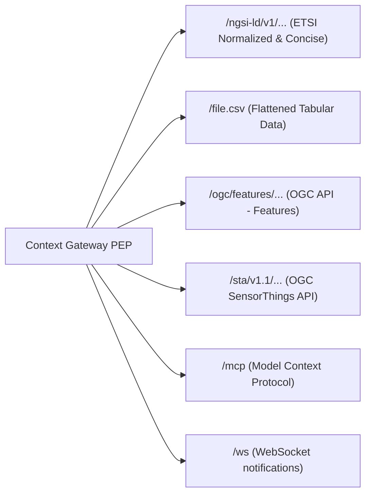

# Endpoint Representations & Translations

The platform provides multi-representation data endpoints through unique URL slugs:
`https://{host}/api/endpoint/{endpointSlug}/...`

The Context Gateway dynamically translates live NGSI-LD context data into the requested representation while enforcing identical authorization policies across all formats ([SP-03](../Requirements/space-surface.md#1-url-scheme)).

---

## 1. Supported Representations Overview



---

## 2. ETSI NGSI-LD Representations

Base Path: `/api/endpoint/{endpointSlug}/ngsi-ld/v1/entities`

### Normalized Representation (Default)

Standard ETSI property-object structure:

```json
{
  "id": "urn:ngsi-ld:WeatherObserved:hel.fi:air-quality:station-01",
  "type": "WeatherObserved",
  "temperature": {
    "type": "Property",
    "value": 22.4,
    "unitCode": "CEL",
    "observedAt": "2026-08-15T12:00:00Z"
  },
  "location": {
    "type": "GeoProperty",
    "value": {
      "type": "Point",
      "coordinates": [19.146, 48.736]
    }
  },
  "@context": "https://uri.etsi.org/ngsi-ld/v1/ngsi-ld-core-context-v1.8.jsonld"
}
```

### Concise Representation

Requested via `Accept: application/json` with `?options=concise`:

```json
{
  "id": "urn:ngsi-ld:WeatherObserved:hel.fi:air-quality:station-01",
  "type": "WeatherObserved",
  "temperature": 22.4,
  "location": {
    "type": "Point",
    "coordinates": [19.146, 48.736]
  }
}
```

---

## 2a. What the NGSI-LD surface answers

The gateway forwards the ETSI resource tree of GS CIM 009 clause 5 under
`/api/endpoint/{endpointSlug}/ngsi-ld/v1/`. The path and the method together name one
operation of the CIM 009 Table 4.20-1 vocabulary, which is the operation the caller's
`Policy` grants have to cover; the vocabulary itself is listed in
[03-domain-model](../Architecture/03-domain-model.md).

**The broker's view answers (T-3643).** The gateway sends the request to the context broker's
view of the Endpoint: `/api/endpoint/{endpointSlug}/ngsi-ld/v1/{rest}` to the view
`{endpointSlug}`, `/cs/{space}/ngsi-ld/v1/{rest}` to the view `cs-{space}`, with the caller's
query as sent. The broker's policy engine decides and narrows the request under the caller the
gateway verified, which the gateway pins in `x-jc-subject`, `x-jc-groups`, `x-jc-roles` and
`x-jc-client`; a caller under a data-space agreement is its participant's DID alone, in `x-jc-did`
(DS-02: no role, no account, never the public caller); the caller's token and cookie do not reach
the broker. The gateway keeps what is
no grant decision: the audience and the token, the rate limit and a form's daily creates, the
identifier (`urn-scheme`), the media type and the core `@context`, the types of the space's
model and the units and relationships it declares, the caps on `lastN` (1000) and `joinLevel`
(3), and the masking of a broker failure (`crates/context-gateway/src/app.rs`). An Endpoint
with a view mapping is its view too: the broker reads it in the target model and answers a write
`405` with `Allow`, and the gateway judges no write body against the source model first (T-3799).
Three kinds of request stay on the gateway's own decision until a view serves them: a write
carrying `If-Match` (T-3789), a Subscription (T-3653), and an Endpoint whose projection has a
`temporalQ` (T-3801).

**The base URL answers ([EP-90](../Requirements/endpoints.md)).** `GET /api/endpoint/{endpointSlug}/ngsi-ld/v1/` is the access URL the DCAT record and the catalogue give a person, so it answers `200` with an entry document rather than `404`. The document is the gateway's own and names only what this caller may read:

```json
{
  "entities": "https://{host}/api/endpoint/{endpointSlug}/ngsi-ld/v1/entities",
  "types": [
    { "type": "BikeHireDockingStation", "query": "https://{host}/api/endpoint/{endpointSlug}/ngsi-ld/v1/entities?type=BikeHireDockingStation" }
  ],
  "access": "https://{host}/api/endpoint/{endpointSlug}/access",
  "schema": "https://{host}/api/endpoint/{endpointSlug}/schema/index.json"
}
```

A query with no selector answers `400 BadRequestData` (CIM 009 5.7.2.4), and its detail points the caller at this document for the types it may query.

Three headers are the gateway's own conclusions and are removed from the request before
anything reads them, whatever the client sent ([GW20](../Requirements/gateway-firewall.md), [EP-21](../Requirements/endpoints.md)):

| Header | Direction | Meaning |
|---|---|---|
| `NGSILD-Tenant` | request | the context space of the resolved endpoint, pinned by the gateway for the internal hop only; no answer of either surface carries it back ([SP-05](../Requirements/space-surface.md)) |
| `NGSILD-Results-Restricted: true` | request | the caller asks to be told when an answer was narrowed ([R22](../Requirements/access-control.md)) |
| `NGSILD-Results-Restricted: true` | response | the answer was narrowed by policy, sent **only** in answer to the request header above; a caller who did not ask reads the answer as what it is ([R22](../Requirements/access-control.md), [GW12](../Requirements/gateway-firewall.md)). Through the broker's view the broker marks it as `Antares-Results-Restricted` and the gateway answers it under this name |
| `NGSILD-Warning` | response | what the caller has to know to read the answer they got: which entity types this request was not allowed to select on, because it filters or orders on an attribute they do not serve on this endpoint. Sent to every caller, and it names only types the caller may read ([MP-02](../Requirements/model-projections.md), [R9](../Requirements/access-control.md)) |
| `NGSILD-Results-Count` | response | the broker's count of the matching entities, forwarded only when the gateway dropped none of them; an answer the gateway narrowed carries no count, because the difference is the number of entities withheld ([R22](../Requirements/access-control.md)) |
| `Link: <…/schema/v{major}/model.schema.json>; rel="describedby"; type="application/schema+json"` | response | where the shapes of what was just answered are, one pair per model major the endpoint publishes: the JSON Schema and, as a second `Link`, `model.shacl.ttl` with `type="text/turtle"`. On every data response of every representation — the NGSI-LD tree, `file.*`, the OGC items and the SensorThings sets — and on no refusal, because a `404` that named a schema would tell a caller who was refused that the endpoint exists ([EP-50](../Requirements/endpoints.md), [EP-03](../Requirements/endpoints.md)). The link is the same for every caller of one endpoint, so it changes no `Vary`; what the document behind it holds is projected to the grant when it is fetched ([EP-47](../Requirements/endpoints.md)) |
| `Cache-Control: private, no-store` | response | every answer is one caller's, because it is the intersection of the URL with that caller's grants; a shared cache may not store it. A document the gateway wants revalidated instead of re-read carries `private, no-cache` with a strong `ETag` ([EP-51](../Requirements/endpoints.md), [R9](../Requirements/access-control.md)) |
| `Vary: Authorization, Accept, Accept-Language, NGSILD-Results-Restricted` | response | what the answer differs by, so a cache keyed on the URL alone cannot mix two callers ([R9](../Requirements/access-control.md)). `Accept-Language` is among them because a `LanguageProperty` is flattened to the caller's own language in a GeoJSON feature (§6) and in the OGC landing page ([EP-37](../Requirements/endpoints.md), [EP-32](../Requirements/endpoints.md)) |
| `X-Userinfo`, `X-Access-Token`, `X-Allowed-Scope-Ids`, `X-Endpoint-Slug`, `X-Consumer-Identity` | request | identity, established from the verified token only |

The signal is asked for rather than volunteered because it tells a caller that something was
there to hide: an unauthorised prober who reads `NGSILD-Results-Restricted` on an answer they
never asked about learns that the space holds more than they saw.

Two query parameters of the read grammar choose *which attribute* a decision is taken on, so each
carries a rule of its own ([AG-85](../Requirements/agents.md), T-2299). `geoproperty` is forwarded
with the caller's own geo query where no grant draws an area; where a grant draws one, the area was
written for CIM 009's default `location`, and a `geoproperty` naming another attribute is `400
BadRequestData` naming the parameter (clause 5.5.2) rather than the grant's polygon tested against
an attribute it was never written for. `geometryProperty` chooses the GeoProperty that becomes the
`geometry` of a GeoJSON answer, which is a value the response narrowing no longer recognises as
that attribute: it is admitted only when the grant covers the attribute and the endpoint does not
hide it, and is otherwise `400` naming the parameter. The MCP surface refuses both in the same
words (§8).

### Problem types

Every refusal is `application/problem+json` (RFC 7807) with a `type` under
`https://joinedcontext.com/errors/`. The body never names the rule that decided
([GW6](../Requirements/gateway-firewall.md)).

| Situation | Status | `type` |
|---|---|---|
| unknown slug, representation not enabled on the endpoint, path outside the NGSI-LD resource tree | 404 | `resource-not-found` |
| a read of one entity the policy refuses (indistinguishable from a miss, [R20](../Requirements/policy-firewall.md)) | 404 | `resource-not-found` |
| no token on an endpoint whose audience is not `public`, or a token whose `aud` does not name this endpoint | 401 | `unauthorized` |
| the operation, type, attribute, scope or area is outside every grant | 403 | `forbidden`; through the broker's view `urn:antares:error:AccessDenied`, the broker's own type, since ETSI Table 6.3.2-1 names no access-denied error, with `code: forbidden` and its `hint` added by the gateway |
| a method the view does not serve on this resource (a merge through a view that grants none) | 405 | the broker's problem document, with `Allow` |
| a verified token whose `azp` names no `ServiceAccount` in the repository, or an account whose project the endpoint's audience excludes | 403 | `forbidden` |
| a write whose entity id is not an NGSI-LD URN of this organization and this space | 400 | `urn-scheme` |
| a write method on a read-only representation (`file.*`, OGC, STA) | 405 | `method-not-allowed`, with `Allow: GET, HEAD, OPTIONS` |
| the broker behind the endpoint did not answer | 502 | `upstream-unavailable` |

- **EP-03** [endpoints] — an unknown slug and an endpoint the caller may not use answer the same 404.
- **GW1** [gateway] — a refused single-entity read answers 404, anything else 403.
- **R22** [policy] — a narrowed answer says so in `NGSILD-Results-Restricted`, to a caller who sent the same header on the request, and carries no `NGSILD-Results-Count` when entities were dropped from it.
- **MP-02** [models] — a request that selects or orders on an attribute a type does not serve leaves that type out of the query, and the answer names it in `NGSILD-Warning`; an MCP tool result carries the same sentence in `structuredContent.warnings`.
- **R9** [policy] — every answer says it is one caller's (`Cache-Control: private`) and what it differs by (`Vary: Authorization`); the gateway says it itself rather than leaving it to the edge.
- **SP-05** [space] — no answer carries `NGSILD-Tenant`.

---

## 3. GeoJSON for maps

An Endpoint publishes no GeoJSON file (T-4597). A map reads GeoJSON from an API:

- `ngsi-ld/v1/entities` with `Accept: application/geo+json`: NGSI-LD's own GeoJSON format (ETSI
  GS CIM 009 §4.5.17), with the same query parameters as any NGSI-LD read (`type`, `q`, `georel`,
  `geometry`, `coordinates`), so a dashboard layer is one query. `options=keyValues` makes each
  Feature's `properties` the plain values. Every Endpoint serves it (EP-10); an entity without a
  `location` is a Feature with a `null` geometry, so a query over non-spatial types answers `200`.
- `ogc/features/collections/{type}/items` (§6), where the Endpoint serves `ogc-features`: the
  OGC API for desktop GIS such as QGIS, whose Features follow EP-09.

---

## 4. Tabular CSV Representation

Path: `/api/endpoint/{endpointSlug}/file.csv`, the one file an Endpoint publishes (EP-42…EP-45;
§5 lists the files that were removed)

Whether an Endpoint answers it is `spec.enabledRepresentations`, beside `ngsi-ld` and `mcp`, which
every Endpoint serves whether or not it lists them (EP-10, EP-24); a manifest that omits the
list serves every standard but SensorThings, less `spec.disabledRepresentations` (EP-104, the matrix in
[Architecture/04](../Architecture/04-context-spaces-and-endpoints.md#configuring-one-endpoint)); the set a manifest may name
is the `Representation` enum of the Endpoint kind (`crates/jc-core/src/kinds/endpoint.rs`), which is
what the published `schemas/kinds/Endpoint.json` validates a manifest against.

`file.csv` accepts the NGSI-LD `GET /entities` query parameters and stream the result as an attachment:

```http
GET /api/endpoint/zt4qm7ge2xdv6ksb3ncf5arw2y/file.csv?type=WeatherObserved&q=temperature>20&humanHeaders=true
```

```http
HTTP/1.1 200 OK
Content-Type: text/csv; charset=utf-8; header=present
Content-Disposition: attachment; filename="zt4qm7ge2xdv6ksb3ncf5arw2y.csv"
```

The file is named after the endpoint slug and the extension, which are both literals the gateway
controls, so nothing a caller sent reaches the `Content-Disposition` header. A download carries no
`ETag`: the body is a whole query answered afresh, and a validator over a paged export would have to
be computed by running the export. Limits: `spec.fileLimits.maxFileRows` /
`spec.fileLimits.maxFileBytes` on the Endpoint manifest (413 when exceeded).

Exports entities as flat tabular data with RFC 4180 compliance.

### Flattening Rules

One entity is one row. A column is the dot-joined path to a leaf value in the entity as the broker returned it, after the policy projection (EP-06), so a column can only ever name an attribute the grant already allowed through.

- `id` and `type` are the first two columns, in that order, and carry the entity URN and its NGSI-LD type.
- Nested members are joined with `.`: a Property's value is `temperature.value`, its metadata `temperature.observedAt`, a sub-property `temperature.accuracy.value`.
- An array whose members are all scalars gives each member a column with its index in brackets: `location.value.coordinates[0]`, `location.value.coordinates[1]`.
- An array that holds an array or an object (the rings of a `Polygon`, the points of a `LineString`, the instances of a multi-attribute) is one cell carrying the array as JSON, in the column named by the array's path: `location.value.coordinates`. A table's width never grows with a geometry's vertex count, so a polygon layer still fits a spreadsheet and the 1600-column table of a CKAN DataStore mirror (EP-65). An answer mixing Points and Polygons carries both the indexed columns and the one JSON column.
- The structural discriminator of an attribute (`"type": "Property"`, `"GeoProperty"`, `"Relationship"`, `"LanguageProperty"`, `"VocabProperty"`, `"JsonProperty"`, `"ListProperty"`) is not data and gets no column. The `type` of a GeoJSON geometry does, because it says which geometry it is.
- A Relationship is its target URN as a string, in the column `refDistrict.object` (EP-08).
- `@context` and the other JSON-LD keywords get no column.
- Columns appear in the order the rows first mention them, so two runs over the same answer produce the same header.
- The encoding is UTF-8 and the separator is a comma; a field carrying a comma, a quote or a newline is quoted per RFC 4180.

```csv
id,type,location.value.type,location.value.coordinates[0],location.value.coordinates[1],temperature.value,temperature.observedAt,refDistrict.object
urn:ngsi-ld:WeatherObserved:hel.fi:air-quality:station-01,WeatherObserved,Point,19.146,48.736,22.4,2026-08-15T12:00:00Z,urn:ngsi-ld:District:hel.fi:air-quality:kallio
```

### Human headers and units (EP-45)

`humanHeaders=true` asks for a header row a person reads instead of a path a program parses. Each column then loses its trailing `.value`, and a Property that carries a `unitCode` (the UN/CEFACT common code of CIM 009, declared in the model per DM-06) gets that code appended in brackets. The `unitCode` column itself is dropped, because it has moved into the header.

```csv
id,type,temperature [CEL],temperature.observedAt
urn:ngsi-ld:WeatherObserved:hel.fi:air-quality:station-01,WeatherObserved,22.4,2026-08-15T12:00:00Z
```

### Paging and limits (EP-44)

The gateway pages through the broker with `limit` and `offset` and appends each page to the answer as it arrives, so the response size is bounded by the endpoint's limits and not by one broker page. `spec.fileLimits.maxFileRows` and `spec.fileLimits.maxFileBytes` are checked while the rows are being written: the first row that would cross either limit ends the download with `413 Payload Too Large` rather than a truncated file that looks complete. An endpoint that declares neither falls back to the gateway's own ceiling.

---

## 5. Files that were removed

Owner decision 2026-10-18 (T-4597): an Endpoint publishes one file format, CSV. One format is one
writer to keep correct and one distribution to describe in DCAT, and the gateway no longer
assembles a ZIP or a Parquet footer in memory. The data stays reachable through the APIs, which
are not files.

| Removed | Was | Read instead |
|---|---|---|
| `file.geojson` | GeoJSON FeatureCollection | §3: `ngsi-ld/v1/entities` with `Accept: application/geo+json`, or `ogc/features/` items |
| `file.json` | one array of NGSI-LD entities | `ngsi-ld/v1/entities`, paged with `limit` and `offset` |
| `file.xlsx` | the CSV rows as an Excel workbook (EP-08) | `file.csv`, which a spreadsheet opens; OData (`odata/v4/`) for Excel and Power BI |
| `file.parquet` | the CSV rows as Apache Parquet (EP-119) | `file.csv`; DuckDB, pandas and Polars read it directly |
| `file.zip` | a bundle of JSON-LD, GeoJSON, CSV, the schemas and a DCAT record (EP-41, EP-51) | `file.csv`, `schema/` (§7a) and the DCAT record of the Endpoint |
| `/cs/{space}/dump/` | `file.zip` over a whole space (SP-13) | the `file.csv` of the space's Endpoints |

Each removed path answers `404`, like any child an Endpoint does not serve. A manifest that still
lists `geojson`, `json`, `xlsx`, `parquet` or `zip` in `spec.enabledRepresentations` or
`spec.disabledRepresentations` is refused with a message that names the removal (EP-104); the
Portal drops them from stored Endpoints once, so no published Endpoint goes dark.

---

## 6. OGC API - Features Part 1

Base Path: `/api/endpoint/{endpointSlug}/ogc/features`

The surface is the broker's: the gateway forwards every request to the `antares-ogc` surface of
the Endpoint's view, `/x/views/{endpointSlug}/ogc/features{rest}`, with the caller's path and query
as sent and the tenant and the verified caller pinned, as for the NGSI-LD surface (T-3643,
T-3752, Antares ADR-0029). The broker builds the documents from the Tenant's LinkML schema
intersected with the view, lowers `filter` (CQL2 text or JSON) into the view's NGSI-LD query where
`q` and `geoQ` say it exactly and evaluates the rest over the view's answer, and its policy
engine decides; a filter only narrows. Antares `docs/src/ogc.md` is the normative description of
the resource tree, the parameters, the conformance classes and the payload. Requirements
EP-29…EP-40.

What the gateway keeps:

| Concern | Behaviour |
|---|---|
| admission | the Endpoint's audience and the caller's token, as on every representation; an unknown slug is `404` |
| writes | none (EP-39): `OPTIONS` is `204` and any other method `405`, both with `Allow: GET, HEAD, OPTIONS`; the broker is not asked |
| links | every `href` and `Link`, `Location` and `Content-Location` the broker names under its own address is moved under `{publicUrl}/api/endpoint/{endpointSlug}/ogc/features` |
| narrowing marker | the broker's `antares-results-restricted` reaches a caller who asked (`NGSILD-Results-Restricted: true`) as `NGSILD-Results-Restricted` (R22) |
| broker failure | a `5xx` is the gateway's `broker-failure` document; the broker's text stays in the log (T-2260) |
| no view | an Endpoint no view serves (a view of another model, a projection with `temporalQ`, a caller under a data-space agreement) answers `501` `ogc-view-unavailable`; read it through the NGSI-LD surface |

### Example: items query

```http
GET /api/endpoint/zt4qm7ge2xdv6ksb3ncf5arw2y/ogc/features/collections/AirQualityObserved/items?bbox=19.10,48.70,19.20,48.76&filter=pm10%20%3E%2050&limit=2
Accept: application/geo+json
```

reaches the broker as

```http
GET /x/views/zt4qm7ge2xdv6ksb3ncf5arw2y/ogc/features/collections/AirQualityObserved/items?bbox=19.10,48.70,19.20,48.76&filter=pm10%20%3E%2050&limit=2
NGSILD-Tenant: air-quality
x-jc-roles: public
```

and the broker answers a `FeatureCollection` whose links name
`https://{host}/api/endpoint/zt4qm7ge2xdv6ksb3ncf5arw2y/ogc/features/…`.

---

## 7. OGC SensorThings API (STA) v1.1

Base Path: `/api/endpoint/{endpointSlug}/sta/v1.1`

Translates IoT observation streams for SensorThings clients.

### Entity Mapping Matrix

| SensorThings Entity | Mapped NGSI-LD Equivalent |
|---|---|
| **Thing** | NGSI-LD `Device` or base entity |
| **Location** | Entity's `location` GeoProperty |
| **Datastream** | Specific observed property grouped by device |
| **Observation** | Temporal observation values from the Temporal API |
| **ObservedProperty** | Attribute metadata and unit definitions |

### Resource tree

An NGSI-LD entity carries its measurements as attributes of itself, where SensorThings splits
them across four linked entity sets. One entity therefore becomes one `Thing`, one `Location`,
and one `Datastream` and one `ObservedProperty` per numeric attribute it declares; an
`Observation` is one instant of one of those attributes. Nothing is stored twice: every set below
is a view of the same projected entity page.

| Method + path | Answers with | Notes |
|---|---|---|
| `GET /` | service document | `value` lists all eight Sensing sets with their URLs, and `serverSettings.conformance` names the three classes this read surface satisfies (`datamodel`, `resource-path`, `request-data`) |
| `GET /Things` | one `Thing` per entity | `@iot.id` is the entity URN, `@iot.selfLink` its own URL |
| `GET /Things('{urn}')` | one `Thing` | `404` for an entity the caller may not read (R20) |
| `GET /Things('{urn}')/Locations` | the entity's `location` | empty `value` when the type declares no `GeoProperty` |
| `GET /Datastreams` | one per entity and numeric attribute | `@iot.id` is `{urn}/{attribute}` |
| `GET /Datastreams('{id}')/Observations` | `GET /ngsi-ld/v1/temporal/entities/{urn}` | one `Observation` per instance of that attribute; needs `retrieveTemporal` |
| `GET /Observations` | every instance of every granted attribute | paged like every other representation |
| `GET /ObservedProperties` | one per attribute the model declares | `definition` is the attribute's slot IRI in the model |
| `GET /Sensors`, `/FeaturesOfInterest`, `/HistoricalLocations` | empty `value` | the platform records no sensor hardware and no feature of interest of its own |
| anything else | `404` | an unmapped set is indistinguishable from an ungranted one (EP-13) |
| any non-safe method | `405` + `Allow: GET, HEAD, OPTIONS` | the representation is read-only (EP-13) |

Identifiers are strings, which v1.1 permits, and are the NGSI-LD identity itself rather than a
number the gateway would have to keep a table for: a `Thing` is the entity URN, a `Datastream` is
`{urn}/{attribute}`, an `Observation` is `{urn}/{attribute}/{observedAt}`. So an id is
addressable after a restart, after a broker swap, and from a client that saw it a year ago.

```json
{
  "@iot.id": "urn:ngsi-ld:Device:hel.fi:air-quality:dev-01",
  "@iot.selfLink": "https://{host}/api/endpoint/{slug}/sta/v1.1/Things('urn:ngsi-ld:Device:hel.fi:air-quality:dev-01')",
  "name": "Kallio",
  "description": "Air quality station",
  "properties": { "type": "Device" },
  "Locations@iot.navigationLink": "…/Things('urn:ngsi-ld:Device:hel.fi:air-quality:dev-01')/Locations",
  "Datastreams@iot.navigationLink": "…/Things('urn:ngsi-ld:Device:hel.fi:air-quality:dev-01')/Datastreams"
}
```

An `Observation` carries `phenomenonTime` from the attribute's `observedAt`, `result` from its
value and `resultTime` from `modifiedAt`; a `Datastream` carries the attribute's `unitCode` as
`unitOfMeasurement.symbol`. An attribute with no numeric value and no `observedAt` is not a
datastream and does not appear, which is what EP-13 means by inexpressible.

### The history of a datastream

`GET /Datastreams('{urn}/{attribute}')/Observations` is the only set that is a series rather
than an instant, so it is the only one read from the temporal tree. It is its own operation:
an endpoint whose policy grants `retrieveEntity` and not `retrieveTemporal` answers `403` here
while still serving every other set, because the history is data the instant answer does not
carry and serving it under the instant grant would make this representation softer than the
NGSI-LD surface it is a view of ([EP-07](../Requirements/endpoints.md)).

Only the named attribute is read (`attrs`), the series is bounded before it is buffered
(`lastN` is the page asked for plus what was skipped), and the answer is projected and narrowed
by the grants' own windows exactly as the instant answer is. `$filter` over `phenomenonTime`
becomes that request's temporal window — `gt`/`ge` an `after`, `lt`/`le` a `before`, both a
`between`, `eq` the instant itself — and, like the spatial predicates of CQL2, it decides the
whole request, so one inside a parenthesis or an `or` is a `400` naming it. `$orderby=phenomenonTime desc`
returns the newest first; any other `$orderby` leaves the broker's order alone rather than
being refused, because an ordering changes no row.

`$count=true` on a series answers `@iot.count` only when the whole series was seen — the broker
is asked for one instant more than the page needs, so a page that came back short is the end of
the history and a page that hit the ceiling is not. A count that is really the ceiling would be
a wrong number on somebody's chart, so it is left out instead.

### `$filter`, `$expand` and paging

`$top` and `$skip` become `limit` and `offset` and are bounded by the endpoint's own ceiling. On a Datastream's `Observations` they become a history depth instead: `$top` and `$skip` together reach at most 999 observations back (the `lastN` cap of GW26), a deeper page answers `400` naming `$skip`, and a `$filter` on `phenomenonTime` reaches older observations.
`$expand=Datastreams` and `$expand=Locations` inline what the navigation link would return, from
the page already fetched, so an expansion costs no second query. `$filter` accepts comparison
operators, `and`, `or`, `not` and `substringof` over an attribute name, and compiles to the same
NGSI-LD `q` the other representations use; anything else answers `400` with the operator named,
because a filter that is silently ignored returns more rows than the caller asked for.

---

## 7a. Schema surface (`schema/`)

Path: `/api/endpoint/{endpointSlug}/schema/index.json` and `…/schema/v{major}/{artifact}`

Publishes what the data contains, in every mainstream formalism, narrowed to the endpoint's grant
(EP-46…EP-52). Two routes: `schema/index.json` is the catalogue, `schema/v{major}/{artifact}` is one
document. `{artifact}` is a file name or its short alias — `model.schema.json`/`json-schema`,
`context.jsonld`/`context`, `model.shacl.ttl`/`shacl`, `model.owl.ttl`/`owl`, `model.rdf.ttl`/`rdf`,
`model.qb.ttl`/`qb` (only when a granted class is a Data Structure Definition, DM-60; `404`
otherwise), `model.linkml.yaml`/`linkml`, `model.md`/`docs`, and `model` for whatever `Accept`
asks for. The
documents are built per request from the checked-in artifacts (or derived from the grants when a
model has none) and carry a strong sha256 `ETag`; nothing is addressed per type, because a major
renders as one document over every class it declares.

```http
GET /api/endpoint/zt4qm7ge2xdv6ksb3ncf5arw2y/schema/index.json
```

```json
{
  "endpoint": "zt4qm7ge2xdv6ksb3ncf5arw2y",
  "models": [{
    "name": "hki-air-quality", "version": 2, "semver": "2.1.0",
    "types": ["AirQualityObserved", "District"],
    "artifacts": {
      "model.linkml.yaml":  { "type": "text/yaml",                 "bytes": 8123,  "sha256": "9c1e…" },
      "model.schema.json":  { "type": "application/schema+json",   "bytes": 15220, "sha256": "4a77…" },
      "context.jsonld":     { "type": "application/ld+json",       "bytes": 2310,  "sha256": "b0d2…" },
      "model.shacl.ttl":    { "type": "text/turtle",               "bytes": 6980,  "sha256": "e51f…" },
      "model.owl.ttl":      { "type": "text/turtle; profile=\"owl\"", "bytes": 5402, "sha256": "17c3…" },
      "model.rdf.ttl":      { "type": "text/turtle",               "bytes": 7115,  "sha256": "c8a9…" },
      "model.md":           { "type": "text/markdown",            "bytes": 11890, "sha256": "0f4b…" }
    },
    "redacted": true
  }]
}
```

`version` is the model's major, the number the path carries; `semver` is its full version.
`redacted` appears only when the grant left something out (never what), and `types` lists the
classes this caller may read. There is no `sourceCommit` and no `generators` block: what a caller
can check is the digest of the bytes it just fetched, which is the `sha256` here and the `ETag`
there.

```http
GET /api/endpoint/zt4qm7ge2xdv6ksb3ncf5arw2y/schema/v2/model.shacl.ttl
```

```turtle
@prefix sh: <http://www.w3.org/ns/shacl#> .

<urn:joinedcontext:model:hki-air-quality:v2:AirQualityObservedShape>
  a sh:NodeShape ;
  sh:targetClass <urn:joinedcontext:model:hki-air-quality:v2:AirQualityObserved> ;
  sh:closed false ;
  sh:property [
    sh:path <urn:joinedcontext:model:hki-air-quality:v2:pm10> ;
    sh:name "pm10" ;
    sh:datatype xsd:float ;
    sh:maxCount 1
  ] ;
  sh:property [
    sh:path <urn:joinedcontext:model:hki-air-quality:v2:qualityBand> ;
    sh:name "qualityBand" ;
    sh:in ( "A" "B" "C" ) ;
    sh:minCount 1 ;
    sh:maxCount 1
  ] .
```

The gateway serves the JSON Schema and the `@context` from the repository checkout, not from a running compiler: `DataModel.spec.artifacts` names the files Model Tools generated beside the LinkML source and committed in the same commit ([DM-02](../Requirements/data-models.md)), so what the endpoint publishes is exactly what was reviewed, minus what the grant forbids. `schema/v{major}/json-schema` is an alias of `model.schema.json`, and `schema/v{major}/context.jsonld` of the `@context`. A model whose artifacts are not in the checkout still answers both: the gateway derives them from the endpoint's grants, so the schema describes what the caller may actually read even before the model is compiled.

The other five formalisms — SHACL, OWL, RDF, the LinkML source and the Markdown — are rendered by the gateway from that same projected model, so every formalism describes one class and slot set and none of them can carry a slot the policy forbids ([Architecture/04 §1a](../Architecture/04-context-spaces-and-endpoints.md#1a-schema-surface-of-an-endpoint-schema)). Their terms live in the model's URN namespace `urn:joinedcontext:model:{name}:v{major}:`, and a rendered SHACL shape is never `sh:closed`, because the entity behind it carries slots this caller may not see.

Every schema response carries a strong `ETag` (sha256 of the body) and revalidates: the document is a projection of the policy set, so a grant that changes changes the schema, and a client holding a stale copy must find out.

Negotiation: `GET schema/v2/model` with `Accept: text/turtle` returns the SHACL, `Accept: text/turtle; profile="owl"` the OWL, `application/schema+json` the JSON Schema, `text/yaml` the LinkML (EP-49). Every data response links here with `Link: rel="describedby"` (EP-50). Slots the endpoint may not read are absent from every format, and the index says `"redacted": true`
for a model something was left out of — **never which class or which slot** (EP-47). A name the
endpoint hides is a thing an administrator chose to hide, so naming it would publish exactly what was
being kept back: a caller who reads `internalNote` in a list of what they may not read has learned the
attribute exists, on which type, and that it was worth hiding. A caller for whom nothing was left out
gets no `redacted` key at all, so its absence is the whole answer and its presence tells them to ask
for wider access rather than to guess. The same rule holds for the MCP `describe_schema` summary,
which is the same document with the reading order added: `recommended: "linkml"` and one entry per
artifact carrying its `format`, `mediaType`, `bytes`, `sha256` and `schema://` URI, LinkML first.
Those entries are listed per model major rather than per model, because a major is what a fetch
addresses — two models of one major render into one document — and the digest is of the bytes that
fetch returns, the same digest the REST index publishes and the same one the `ETag` carries.

### Mappings (`schema/v{major}/mappings/`)

Path: `…/schema/v{major}/mappings/` (the index) and `…/schema/v{major}/mappings/{file}` (EP-53).

The Mappings the project maintains from this model to another one ([Architecture/11 §7.5](../Architecture/11-data-models.md#75-mappings-across-context-spaces-and-instances-federation), outbound) are published beside the model they read, so a consumer can run the same transformation the platform runs. A `kind: Mapping` is published on an Endpoint's `schema/v{major}/` when all of these hold:

- it is in the repository the gateway applies, which is a merged Change: a preview's Mapping is never served, because nobody approved it;
- it belongs to the Endpoint's project and space (`spec.contextSpaceRef`), and its `spec.source` is a DataModel the Endpoint serves, at that major;
- both compiled artifacts, `spec.artifacts.bloblang` and `spec.artifacts.gatewayIr`, are committed beside it and readable, so what is published is what was reviewed (DM-52);
- it has no `native` block and no member named `secretRef` anywhere: a native block reads names nobody can check against the grant, so it stays unpublished.

Per caller, a Mapping is listed only when every source class and slot its `class_derivations` read (`populated_from`, the `{slot}` names of an `expr`, and a slot's own name when it names no source) is in the JSON Schema this caller is served at that major. A Mapping that reads a hidden name is absent and the index says `"redacted": true`, as §7a does for the model, never which Mapping. An Endpoint with nothing to publish answers the index with an empty list; a file of a Mapping not listed answers `404`.

```json
{
  "endpoint": "zt4qm7ge2xdv6ksb3ncf5arw2y",
  "version": 2,
  "mappings": [{
    "name": "hki-air-quality-to-sdm",
    "title": { "en": "HKI air quality → SDM AirQualityObserved" },
    "source": { "name": "hki-air-quality", "version": "2" },
    "target": { "name": "sdm-airqualityobserved", "version": "1" },
    "artifacts": {
      "hki-air-quality-to-sdm.linkml-map.yaml": { "type": "text/yaml",        "bytes": 1840, "sha256": "5be0…" },
      "hki-air-quality-to-sdm.blobl":           { "type": "text/plain",       "bytes": 912,  "sha256": "a01c…" },
      "hki-air-quality-to-sdm.ir.json":         { "type": "application/json", "bytes": 1377, "sha256": "e9f2…" }
    }
  }]
}
```

`{name}.linkml-map.yaml` is `spec.transformation`, the LinkML-Map `TransformationSpecification`, as YAML; `{name}.blobl` and `{name}.ir.json` are the committed files byte for byte. Each file carries a strong sha256 `ETag`. The schema index links each major that publishes a Mapping with `Link: <…/schema/v{major}/mappings/>; rel="https://joinedcontext.com/rel/mappings"`, and the Endpoint's DCAT-AP record lists every file this caller may fetch as a `dcat:distribution` with its `dcat:accessURL`, `dcat:mediaType`, `spdx:checksum` and `dcterms:conformsTo` (EP-68), so the CKAN dataset carries one resource per file.

## 7b. Access surface (`access`)

Path: `/api/endpoint/{endpointSlug}/access` and `POST …/access/check`. The space surface links a
`/cs/{space}/access` child but the router does not serve one yet (**T-2373**), so a caller reads the
grants through the endpoint slug.

Returns the caller's effective grants (EP-55…EP-60). Same decision as the data paths, four
representations chosen by `Accept`, read in the order the caller wrote them: `application/json` (and
`application/ld+json`) for the AuthZEN document, `application/odrl+json` for the ODRL policy,
`text/turtle` for the same policy as RDF, and
`application/vnd.joinedcontext.grant-ast+json` for the residual as a condition tree. An `Accept` this
surface does not serve is answered with the AuthZEN document rather than a `406`: the caller asked
what they may do, and there is always an answer to that.

Who answers (plan 5.6, **T-3649**): the gateway admits the caller as on the data paths (`404` for an
unknown slug, `401`/`403` from the audience) and then reads the Endpoint's broker view, `GET
/x/views/{view}/access` and `POST /x/views/{view}/access/check`, under the tenant and the verified
caller (`x-jc-*`) and nothing else of the request. The broker writes the document and decides the
check from the rule table its engine enforces with, so the description cannot drift from the
enforcement (EP-60). The gateway adds what belongs to the Endpoint and not to the grants: the
`resource` (slug and space), `limits`, the licence's duties on every ODRL permission (EP-79) and the
ODRL `uid` on its own public access URL, over the rules with those duties; it writes the Turtle from
that ODRL document. Through a view, `actions` lists only the operations the view serves, and a
Policy with no `information` is one entry of type `"*"`. An answer the gateway cannot read, or a
broker failure, is `502`/`5xx` `broker-failure` naming nothing the broker said; the broker's own
refusal (`404` for a view it does not hold) is passed on. The gateway keeps no document or decision
of its own (T-3650): an Endpoint the broker can hold no view of (a slug longer than a view id, which
the Portal's view writer refuses and names in the Endpoint's status) answers `503` `no-view` on
`access`, `access/check` and `access/simulate`, and nothing is decided for it. The MCP
`describe_access` tool and the `access://{slug}` resource read the same document.

The default, `application/json`, is the AuthZEN permissions document: one entry per entity type the caller may touch, and nothing about the types it may not (EP-59, [R20](../Requirements/policy-firewall.md)).

```http
GET /api/endpoint/zt4qm7ge2xdv6ksb3ncf5arw2y/access
Accept: application/json
```

```json
{
  "subject": { "type": "role", "id": "public" },
  "resource": { "type": "endpoint", "id": "zt4qm7ge2xdv6ksb3ncf5arw2y", "space": "air-quality" },
  "permissions": [{
    "resource": { "type": "AirQualityObserved", "idPatterns": ["^urn:ngsi-ld:AirQualityObserved:hel\\.fi:air-quality:.*$"] },
    "actions": ["queryEntity", "retrieveEntity", "queryTemporal"],
    "attributes": ["dateObserved", "location", "pm10", "pm25"],
    "constraints": { "q": "pm10>=0", "scopeQ": "/geo/FI/HKI" }
  }],
  "prohibitions": []
}
```

`actions` are CIM 009 Table 4.20-1 names with groups expanded — never `"*"`, because the expanded
list is what the caller can check a request against. `attributes` is the readable and writable slots,
or the string `"*"` when the grant names no whitelist and therefore reaches every attribute of the
types it names. `constraints` carries whichever of `q`, `scopeQ`, `geoQ` and `temporalQ` the grant
sets, and nothing for the ones it does not. An Endpoint that declares a rate limit adds a `limits`
object (`requestsPerMinute`, and `burst` when it is set) beside `permissions`, so a caller reads the
limit before meeting it. A `prohibitions` entry overrides a permission that would otherwise match
([GW8](../Requirements/gateway-firewall.md)).

`POST …/access/check` answers one prospective request. The body is an AuthZEN request:
`action.name` is required and is a CIM 009 operation, `resource.type` is optional and narrows the
question to one entity type. A body that is not JSON or that omits `action.name` is a `400` saying
which. A permitted decision names the policy's assigner, a refusal names nothing, because the reason
is the rule and the rule is not the caller's business
([GW6](../Requirements/gateway-firewall.md)):

```http
POST /api/endpoint/zt4qm7ge2xdv6ksb3ncf5arw2y/access/check
Content-Type: application/json

{"action": {"name": "retrieveEntity"}, "resource": {"type": "AirQualityObserved"}}
```

```json
{"decision": true, "context": {"reason": "policy_grant_matched", "assigner": "did:web:hel.fi"}}
```

A prohibition covering the action ends it, whatever any permission says, and answers
`{"decision": false}`.

`POST …/access/simulate` answers the same question for someone else (EP-103, T-3311): the decision
`access/check` would give a named subject on this Endpoint, from the same admission and the same
decider, so the two cannot disagree. Through a view the broker's engine decides: the gateway asks the
view's `access/explain` (Antares `addons/joinedcontext-policy/README.md` section 4) under the `x-jc-*`
headers the subject's own token would pin (T-3881). It answers the Portal's own client alone: a token minted for the
audience `context-gateway-simulate` (which no data path accepts), whose `azp` is the client the
deployment names (`portal-api` by default) and whose user is that
client's service account, so a person's token of the same client is refused. Any other token is
`403`, a missing one `401`. The Portal
decides who may ask (an organization administrator) and writes the audit record naming both
subjects; the gateway logs the call with the simulated subject beside the Portal's account.

The body is the `access/check` request with a `subject`, at most 64 KiB. `subject` holds exactly one
of three shapes: a person (`user`, with the `groups` and realm `roles` the Portal resolved for
them), a member of `groups` or `roles` with no person (`user` absent: no Policy written for one
person applies), or a `serviceAccount` by its Keycloak client id (`{project}-{name}`). An empty
`subject` is the public caller. An unknown member, a `serviceAccount` beside a person, an
`action` without a `name`, or a `resource` without an `action` is a `400` saying which.

```http
POST /api/endpoint/zt4qm7ge2xdv6ksb3ncf5arw2y/access/simulate
Authorization: Bearer <the Portal's service-account token>
Content-Type: application/json

{"subject": {"user": "demo.viewer", "groups": ["helsinki"], "roles": ["viewer"]},
 "action": {"name": "retrieveEntity"}, "resource": {"type": "AirQualityObserved"}}
```

```json
{"decision": true,
 "context": {"reason": "policy_grant_matched", "policy": "public-air", "assigner": "did:web:hel.fi"}}
```

Unlike `access/check`, the answer names why in every case, because its reader is an administrator
who may read every Policy: `policy_grant_matched` with the granting `policy`, `prohibited` with the
refusing `policy`, `no_grant` when no Policy grants the action on the type, and `not_admitted` when
the Endpoint's audience refuses the subject before any Policy is read (EP-14). `policy` is the
Policy's manifest name: the engine's `{project}/{name}` and `{project}/{name}@{endpoint}` ids are
answered as `{name}`, and an id of any other shape is left out. A broker that does not know the
view, or fails, is the answer itself (its `404`, the gateway's `502`), never a decision.

With no `action`, the question is everything the subject is granted here (T-3792, the Portal's
Access explorer): the answer is the AuthZEN document of `GET /access` as a token of theirs would
read it, with `admitted: true` and `policies`, the manifest names of the Policies in force for the
subject, permissions and prohibitions alike. A subject the audience refuses gets
`{"admitted": false}` and nothing else. The document lists only the types a grant names (EP-59).

```json
{"admitted": true, "policies": ["ovzdusie-writes"],
 "subject": {"type": "user", "id": "ada"},
 "resource": {"type": "endpoint", "id": "p9d2wc5kzn8mth4rqvb7xj3sfy", "space": "ovzdusie"},
 "permissions": [{"resource": {"type": "AirQualityObserved"}, "actions": ["updateAttrs"],
                  "attributes": "*"}],
 "prohibitions": []}
```

The other three representations:

```http
GET /api/endpoint/zt4qm7ge2xdv6ksb3ncf5arw2y/access
Accept: application/odrl+json
```

```json
{
  "@context": ["http://www.w3.org/ns/odrl.jsonld", "https://joinedcontext.com/odrl/ngsi-ld/v1/context.jsonld"],
  "@type": "Set", "uid": "https://hel.example.fi/api/endpoint/zt4qm7ge2xdv6ksb3ncf5arw2y/access#sha256:4a1f",
  "assigner": "did:web:hel.fi", "assignee": "did:web:hel.fi:users:aino",
  "permission": [{
    "action": ["ngsi-ld:queryEntity", "ngsi-ld:retrieveEntity", "ngsi-ld:queryTemporal"],
    "target": { "@type": "ngsi-ld:EntityType", "uid": "AirQualityObserved",
                "refinement": [{ "leftOperand": "ngsi-ld:attrs", "operator": "isAnyOf", "rightOperand": ["pm10", "pm25", "location", "dateObserved"] }] },
    "constraint": [
      { "leftOperand": "ngsi-ld:scopeQ", "operator": "isPartOf", "rightOperand": "/geo/FI/HKI" },
      { "leftOperand": "ngsi-ld:geoQ",  "operator": "ngsi-ld:within", "rightOperand": { "@type": "geojson:Polygon", "coordinates": "[[…]]" } },
      { "leftOperand": "dateTime", "operator": "gteq", "rightOperand": "P-1D" }
    ]
  }]
}
```

The same ODRL policy is served as RDF to a caller that sends `Accept: text/turtle` — one document,
two serializations, so a catalogue that reads Turtle needs no JSON-LD processor.

An Endpoint that declares a licence in `spec.catalog.license` adds the licence's duties to every
permission: `"duty": [{"action": "attribute"}]` for CC BY and ODC-By, the same plus
`{"action": "cc:ShareAlike"}` for CC BY-SA and ODbL, nothing for CC0 and PDDL (EP-79,
[Architecture/04 §3a](../Architecture/04-context-spaces-and-endpoints.md#3a-the-endpoints-own-dcat-ap-record)).

```http
GET /api/endpoint/zt4qm7ge2xdv6ksb3ncf5arw2y/access
Accept: application/vnd.joinedcontext.grant-ast+json
```

```json
{
  "AirQualityObserved": {
    "operations": ["queryEntity", "retrieveEntity", "queryTemporal"],
    "project": ["pm10", "pm25", "location", "dateObserved"],
    "q": "pm10>=0",
    "where": { "type": "compound", "operator": "and", "value": [
      { "type": "field", "operator": "scope_under", "field": "scope", "value": "/geo/FI/HKI" },
      { "type": "field", "operator": "geo_within",  "field": "location", "value": { "type": "Polygon", "coordinates": [[]] } },
      { "type": "field", "operator": "gte", "field": "observedAt", "value": { "relative": "P-1D" } }
    ] }
  }
}
```

An unconstrained principal (for example a `service` App with full write rights on its own space)
receives `"project": "*"` and no `where`; `operations` is the expanded list of what it may do, as in
the AuthZEN document. Types the caller may not see are absent.

`scopeQ`, `geoQ` and `temporalQ` have a known shape, so they become `where` branches. A residual `q` does not: it is an NGSI-LD query filter, and [R56](../Requirements/policy-firewall.md) allows exactly one grammar for those, the broker's own parser compiled to Wasm, which the gateway does not host. So `q` travels verbatim beside `where`, and a client applies it as it applies any other NGSI-LD filter. Leaving it out would understate the residual and let a client compile a filter wider than its grant.

## 7c. Filter preview (`preview`)

The Portal's preview ([API/01 §40](01-portal-api.md), T-3802) replaces this route: it compiles the
draft into the Endpoint's broker view and asks the broker. The gateway route below answers until the
gateway's NGSI-LD pipeline goes (T-3644).

Path: `POST /api/endpoint/{endpointSlug}/preview` ([EP-85](../Requirements/endpoints.md)). It answers
one page of what the Endpoint would serve if its filter were the draft in the body, which is how the
Portal's filter editor shows its left side while the person edits ([EP-86](../Requirements/endpoints.md)).
The route sits beside `access`, outside the `ngsi-ld/v1` tree, because a draft is not a CIM 009 query.

```http
POST /api/endpoint/zt4qm7ge2xdv6ksb3ncf5arw2y/preview
Authorization: Bearer eyJ…
Content-Type: application/json

{
  "projection": {
    "classes": [{ "name": "Event", "slots": ["name", "startDate", "endDate", "location"] }],
    "filter": { "q": "endDate>=\"2026-09-25T00:00:00Z\"" }
  },
  "hiddenAttributes": ["source"],
  "type": "Event",
  "id": ["urn:ngsi-ld:Event:hel.fi:helsinki:agent-123", "urn:ngsi-ld:Event:hel.fi:helsinki:agent-124"],
  "limit": 50,
  "offset": 0
}
```

| Member | Required | Meaning |
|---|---|---|
| `projection` | no | The draft `ModelProjection`: `classes` (at least one, each with its `slots`, empty for identity only) and an optional `filter` (`q`, `scopeQ`, `geoQ`, `temporalQ`), validated like the manifest ([MP-01](../Requirements/model-projections.md)). `null` or absent means the draft names no projection. |
| `hiddenAttributes` | no | The draft `spec.projection.hiddenAttributes`; empty or absent hides nothing. |
| `type` | yes | The entity type of the page, as in a query. |
| `id` | no | At most 100 entity ids: the page is restricted to them, which is how the Portal aligns the two sides row by row. |
| `limit`, `offset` | no | The page, 1 to 100 entities (default 50) from `offset` (default 0). |

Unknown members are refused with `400`. The answer is the answer of `GET …/ngsi-ld/v1/entities?type=…&count=true`
under the draft: the normalized entities as a JSON array and the total in `NGSILD-Results-Count`.
The draft takes the place of the saved projection and hidden attributes; the Endpoint's Policies,
audience and view mapping stay as saved, so the preview never serves what the Policies do not grant,
and the same draft saved answers the same entities through the ordinary read.

Who may ask: a caller the space's canonical surface `/cs/{space}` admits. Anybody else, anonymous or
not, gets the `404` an unknown slug gets, because a draft can name a class or an attribute the saved
projection does not publish yet. The draft is evaluated for the audience: as the anonymous caller on a
`public` Endpoint, as the caller on the others. A refused draft (`400`) names the member at fault:
`projection.classes: a projection exposes at least one class (MP-01)`.

## 8. Model Context Protocol (MCP)

Path: `/api/endpoint/{endpointSlug}/mcp`

Exposes the endpoint as an autonomous tool server for AI agents ([SP-14](../Requirements/space-surface.md#4-per-space-mcp-instances)).

One `POST` carries one JSON-RPC message, one response comes back, and nothing is kept between calls: the next `tools/list` already reflects a grant that changed a second ago (SP-19). A notification, a message with no `id`, is answered `202` with an empty body.

**The broker's MCP surface (T-3647).** The gateway verifies the caller, applies the Endpoint's rate limit and the domain gate on a write, and forwards each request to the broker's MCP surface of the Endpoint's view (`/x/views/{endpointSlug}/mcp`; `/cs/{space}/mcp` to `cs-{space}`) under the verified caller. The tools, their input schemas, paging and write confirmation are the broker's (Antares `docs/src/mcp.md`): `type` is a list, `cursor` is the opaque `nextCursor` of the previous answer passed back unchanged (no cursor on a first page), `batch_upsert` replaces `upsert_entity`, and a write is confirmed by the person through the 2026-07-28 multi round-trip request (`InputRequiredResult`, then the same call with `inputResponses` and `requestState`). The gateway still answers `describe_access`, `describe_schema` and the `access://` and `schema://` resources itself, added to the broker's `tools/list` and `resources/list`; it caps `joinLevel` at 3 and `lastN` at 1000 as on the NGSI-LD surface, and asks the broker with `Accept: application/json, text/event-stream` whatever the client sent. An Endpoint with a view mapping, a caller holding a data-space agreement and a space that federates registrations stay on the gateway's own tools until the hub forwards too (T-3808).

```bash
curl -sS -X POST "https://{host}/api/endpoint/{endpointSlug}/mcp" \
  -H 'content-type: application/json' \
  -d '{"jsonrpc":"2.0","id":1,"method":"tools/call","params":{"name":"query_entities","arguments":{"type":["AirQualityObserved"],"limit":2}}}'
```

```json
{
  "jsonrpc": "2.0",
  "id": 1,
  "result": {
    "isError": false,
    "content": [{ "type": "text", "text": "the same entities, serialised as JSON for a model that reads text" }],
    "structuredContent": {
      "entities": [
        { "id": "urn:ngsi-ld:AirQualityObserved:hel.fi:air-quality:station-01", "type": "AirQualityObserved" }
      ],
      "restricted": true
    }
  }
}
```

### Dynamic Tool Surface

Tools are generated from the caller's own grants, one tool per CIM 009 operation. The catalogue, the parameters and the resource URIs are specified once in [Architecture/07 §2](../Architecture/07-agents-and-mcp.md#2-tool-catalogue-specification).

Every query parameter §2a lists for the NGSI-LD read surface is an argument of the tool that maps to the same operation, under the same name and with the same meaning, from the one table both surfaces share ([AG-84](../Requirements/agents.md), [Architecture/07 §2](../Architecture/07-agents-and-mcp.md#the-shared-read-parameter-table-ag-84)). Two differences are deliberate and are the only two: where the REST parameter is a comma-separated string (`type`, `id`, `attrs`, `pick`, `omit`, `datasetId`, `containedBy`) the argument is a JSON list, which a schema can bound and a client can build without quoting rules; and `offset` is named `cursor`, because the structured result hands the next one back as `nextCursor`.

An argument never widens a read. For the same request and the same token, the entities, attributes and members an MCP answer carries are what the REST answer carries — a projection argument selects from what the grant already allows and can never reach past it ([AG-85](../Requirements/agents.md)).

Three answers are worth knowing before writing a client:

- A tool the caller may not use is **absent from `tools/list`**, and calling it by name answers `unknown tool`, the same words a tool nobody defined gets (SP-20).
- A refusal by the policy comes back as a tool error (`isError: true`) with the status and the problem document's own words, never as an empty result an agent would read as "there is nothing there".
- An argument that is not in the tool's schema, and any attempt to pass `space`, `tenant`, `contextspace`, `slug` or `endpoint`, is refused before a broker request exists (AG-05, AG-31).
- A tool that writes answers the first call with an `InputRequiredResult` and writes nothing; the client asks the person and repeats the same call with `inputResponses` and the `requestState` it was given, which is sealed to the view, the caller, the tool and these arguments, expires after ten minutes and is spent once ([AG-08](../Requirements/agents.md), Antares `docs/src/mcp.md` §3). On the gateway's own tools (the fallbacks above) the older `params.elicitation` round trip stays until T-3648 ([Architecture/07 §3](../Architecture/07-agents-and-mcp.md#3-human-in-the-loop-elicitation--confirmation-flow)). A value outside its schema is refused the same way: a `type` that is not an NGSI-LD type name is a tool error naming the parameter, never an empty result a caller would read as "there is nothing there" (AG-21). The refusal names the parameter and the rule it broke — the pattern, the length, the formalisms `format` accepts — and never repeats the value that was sent: a tool result is read by a model, so a refusal that quotes the argument carries whatever was typed into the next prompt ([GW31](../Requirements/gateway-firewall.md), [AG-21](../Requirements/agents.md)).
- **`structuredContent` is an object, never a bare list** (MCP's own rule and the tool's output schema): the entities sit under `entities`, and `restricted: true` sits beside them when the policy narrowed the answer (AG-13, R22). The marker says that something was removed, never what. Unlike the REST header it is not opt-in: a tool result is read by a model, which has no way to ask for it first, and the field is what AG-13 makes the agent's own signal.
- **A unit beside its code.** Every object of a tool result that carries a `unitCode` the UN/CEFACT Recommendation 20 list knows also carries `unit`, the symbol a person reads (`"unitCode": "GQ", "unit": "µg/m³"`), or the unit's name where Rec 20 gives no symbol, in `structuredContent` and in the JSON text item alike; an unknown code and an object that already has `unit` are left as they are. A model reads a bare `GQ` as no unit. The gateway adds it to the broker's answer; the stored entity and the NGSI-LD representation are unchanged (T-4373, DM-06).

Unauthenticated access follows the Endpoint's audience: a `public` Endpoint answers `tools/list` and every read tool with no token, everything else answers `401` with `WWW-Authenticate: Bearer resource_metadata="https://{host}/api/endpoint/{endpointSlug}/.well-known/oauth-protected-resource"` (AG-32).

### The hub (`/api/mcp`)

One address over every Endpoint ([EP-87](../Requirements/endpoints.md), [ADR-N-025](../Decisions/adr-n-025-one-mcp-connector-several-endpoints.md)). Without a token it answers over the `public` Endpoints that serve `mcp`; with a token over those plus the ones the token reaches (`endpoint:*` reaches every Endpoint the person may read, EP-88). `list_endpoints` takes `q`, `type`, `attribute`, `space`, `access`, `limit` and `cursor` (EP-111); every other tool is the Endpoint's own tool with one more argument, `endpoint`, a slug `list_endpoints` answered (EP-112).

```bash
curl -sS -X POST "https://{host}/api/mcp" \
  -H 'content-type: application/json' \
  -d '{"jsonrpc":"2.0","id":1,"method":"tools/call","params":{"name":"list_endpoints","arguments":{"type":"AirQualityObserved","limit":1}}}'
```

```json
{
  "jsonrpc": "2.0",
  "id": 1,
  "result": {
    "isError": false,
    "content": [{ "type": "text", "text": "the same rows, serialised as JSON for a model that reads text" }],
    "structuredContent": {
      "endpoints": [
        {
          "slug": "k4y7pq2mzt6vhx3nbwrs5cjd8f",
          "title": { "en": "Air quality" },
          "description": { "en": "Hourly air quality of the city's stations" },
          "space": "ovzdusie",
          "access": "public",
          "types": ["AirQualityObserved"],
          "attributes": { "AirQualityObserved": ["dateObserved", "location", "no2", "pm10"] },
          "temporal": true,
          "dcat": "https://{host}/api/endpoint/k4y7pq2mzt6vhx3nbwrs5cjd8f/",
          "mcp": "https://{host}/api/endpoint/k4y7pq2mzt6vhx3nbwrs5cjd8f/mcp",
          "schema": "https://{host}/api/endpoint/k4y7pq2mzt6vhx3nbwrs5cjd8f/schema/v1/model.linkml.yaml"
        }
      ],
      "total": 1
    }
  }
}
```

## 8a. WebSocket (`ws`)

Path: `wss://{host}/api/endpoint/{endpointSlug}/ws`

One connection carries NGSI-LD Subscriptions made over the socket and the Notifications they produce, in the TS 104 243 `{metadata, body}` envelope (EP-106). The gateway authenticates the upgrade like any request and forwards it to the broker view's `/x/views/{view}/ws`, so a notification carries only what the caller's grant reads. Messages, limits, resume and client examples are on their own page: [API/07](07-websocket.md).

## 8b. Domain standards and the data model they need

A domain standard, such as iCalendar, is a representation of one Smart Data Models type in another standard's terms. It is served only where `spec.enabledRepresentations` lists it (never by the EP-104 default), and only on an Endpoint whose Context Space's data model has that type with every attribute the standard's mandatory fields come from, each one a slot marked `required: true` (EP-125). The requirement is code: the platform's `Representation::requirement()` declares it, and [`schemas/surface-requirements.md`](https://github.com/marek-mraz-jc/joinedcontext-platform/blob/main/schemas/surface-requirements.md) in the platform repository is generated from it and checked against it by the platform's tests. This section quotes that file.

### iCalendar (`ical`, RFC 5545)

Smart Data Models type: `Event` (`https://smartdatamodels.org/dataModel.Event/Event`).

| Field | Standard | Source attribute | Mandatory |
|---|---|---|---|
| `UID` | RFC 5545 §3.6.1, §3.8.4.7 | entity `id` | yes |
| `DTSTAMP` | RFC 5545 §3.6.1, §3.8.7.2 | entity `modifiedAt` (system) | yes |
| `DTSTART` | RFC 5545 §3.6.1, §3.8.2.4 | `startDate` | yes |
| `SUMMARY` | RFC 5545 §3.8.1.12 | `name` | yes (a calendar entry without a title is of no use) |
| `DTEND` | RFC 5545 §3.8.2.2 | `endDate` | no: absent, the event has no end |
| `DESCRIPTION` | RFC 5545 §3.8.1.5 | `description` | no |
| `LOCATION`, `GEO` | RFC 5545 §3.8.1.7, §3.8.1.6 | `address`, `location` | no |
| `URL` | RFC 5545 §3.8.4.6 | `url` | no |

`id` and `modifiedAt` belong to every entity, so the model has to declare `startDate` and `name` as required slots of `Event`.

### The refusal

```text
Endpoint banskabystrica/banskabystrica-podujatia: `ical` needs the type Event with the required attribute(s) startDate in the data model of space banskabystrica-verejne (EP-125)
```

### An entity that lacks a mandatory attribute

An entity read without `startDate` or `name` is left out of the feed and counted in `antares_surface_records_skipped_total{surface="ical", attribute="startDate"}`; the feed stays valid RFC 5545 (EP-126).

---

## 9. The Endpoints a token reaches (`GET /api/endpoints`)

Path: `/api/endpoints`, on the gateway's host, outside any one Endpoint.

The REST twin of the hub's `list_endpoints` ([EP-105](../Requirements/endpoints.md), [ADR-N-025 §4a](../Decisions/adr-n-025-one-mcp-connector-several-endpoints.md)): the Endpoints this token reaches and may read something through, whatever they serve. A person's token, a hub token with `endpoint:` scopes, and a ServiceAccount's `client_credentials` token each get the list their token opens (EP-88). Without a token the answer lists the `public` Endpoints only, as the hub does (EP-87); nothing internal is named. The filters and the row fields are the hub's (EP-111).

```bash
curl -sS "https://{host}/api/endpoints?limit=2" -H "authorization: Bearer $TOKEN"
```

```json
{
  "endpoints": [
    {
      "slug": "k4y7pq2mzt6vhx3nbwrs5cjd8f",
      "title": { "en": "Air quality" },
      "space": "ovzdusie",
      "types": ["AirQualityObserved"],
      "representations": ["ngsi-ld", "mcp", "ogc-features"],
      "surfaces": {
        "ngsi-ld": "https://{host}/api/endpoint/k4y7pq2mzt6vhx3nbwrs5cjd8f/ngsi-ld/v1/",
        "mcp": "https://{host}/api/endpoint/k4y7pq2mzt6vhx3nbwrs5cjd8f/mcp",
        "ogc-features": "https://{host}/api/endpoint/k4y7pq2mzt6vhx3nbwrs5cjd8f/ogc/features/"
      },
      "mcp": "https://{host}/api/endpoint/k4y7pq2mzt6vhx3nbwrs5cjd8f/mcp",
      "schema": "https://{host}/api/endpoint/k4y7pq2mzt6vhx3nbwrs5cjd8f/schema/v1/model.linkml.yaml"
    }
  ],
  "total": 5,
  "nextCursor": 2
}
```

`limit` is 1 to 100 (default 50); `cursor` is the previous page's `nextCursor`; `q`, `type`, `attribute`, `space` and `access` narrow the list (EP-111). Any other parameter, or a value outside those, is `400`; a filter that matches nothing is an empty list. `types` are the entity types this caller may read there, not every type the Endpoint serves. The list is computed from the token on every request, so a revoked grant is gone on the next call. Each call spends one request of the hub's per-subject bucket (EP-87) and writes one audit line naming the principal and the count.

## 10. In the open data portal

A published Endpoint (`spec.publish.ckan`) is one CKAN dataset with one resource per surface it serves (EP-108). Each surface resource says in its description how to use it, so a person who finds the dataset can start without reading this page:

| Resource | Format | Usage description names |
|---|---|---|
| NGSI-LD API | `NGSI-LD` | a `curl` request for the first entities of a type |
| WebSocket | `WebSocket` | the `websocat` line of [API/07 §5](07-websocket.md#5-examples) and a link to that page |
| MCP | `MCP` | the client entry (`url`, `transport: http`) for an MCP client |
| OGC API - Features | `OGCFEAT` | QGIS: Layer, Add Layer, Add WFS / OGC API - Features Layer, the landing URL |
| OData v4 | `OData` | Excel: Data, Get Data, From OData Feed; Power BI: Get data, OData feed; the service URL |
| CSV | `CSV` | that the file is generated on each download from live data |
| Schema index and artifacts | `JSON`, `LinkML`, `SHACL`, … | the model version and the sha256 (EP-68) |

On a public Endpoint the NGSI-LD, OGC API - Features, OData and SensorThings resources also link the Endpoint's public page (`https://{host}/d/{endpointSlug}`), whose "Standards" part lists the fields each standard filters on and example queries that answered with the dataset's own data when the Portal last read it ([API/01 §16a](01-portal-api.md#16a-the-catalogue-ep-81-ep-82)); the catalogue holds the link, never a copy of the examples, which would go stale between publication runs.

Above the resources, the dataset page shows the "Connect an AI assistant" panel (EP-113): the hub's URL and copy buttons for Claude, VS Code, Cursor and a plain `mcpServers` entry. The panel names the hub, never this dataset's slug, so one installation serves the whole catalogue and the agent picks the Endpoint with `list_endpoints`. The catalogue's home page and the Portal's Endpoint page show the same panel.

Publishing widens discovery and never data: every URL is the Endpoint's own, answers under its Policy, and carries no token (EP-110). A restricted Endpoint's resources are links a person without a grant cannot open.

What the catalogue keeps current (EP-109):

| Resource kind | What CKAN holds | How it stays current |
|---|---|---|
| DataStore table (`spec.publish.ckan.datastore`) | a copy of the rows, one table per entity type | row by row on each change (`refresh: onChange`) or on each reconcile (`onReconcile`), deletions included (EP-65) |
| File resource (`file.csv`) | a link to the live download | the file is built on each request; `metadata_modified` moves on the next publication run after the data changed |
| API resource (NGSI-LD, WebSocket, MCP, OGC, OData) | a link | always live; CKAN holds no copy |
| Schema artifact | a link and the sha256 of its model version | a new model version adds new artifacts with their own hashes (EP-68) |

A surface the Endpoint stops serving, by `spec.disabledRepresentations` or an explicit list, loses its resource in the same run (EP-108).

## Related

- [SP-03](../Requirements/space-surface.md) — referenced above.
- [00-intro](00-intro.md) — all API surfaces.
- [07-websocket](07-websocket.md) — live updates over one WebSocket.
- [04-context-spaces-and-endpoints](../Architecture/04-context-spaces-and-endpoints.md) — the model behind the endpoints.
